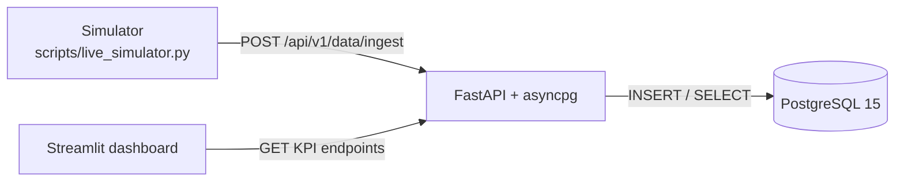

<h1 align="center">Retail Analytics Platform</h1>
<p align="center"><strong>Simulated retail transactions → validated FastAPI ingestion → normalized PostgreSQL → Streamlit KPI dashboard</strong></p>

<p align="center">
  <a href="https://github.com/Nirrmitt/Retail-Analytics-Platform"></a>
  <a href="https://nirrmitt.github.io/NRT-Terminal/demos/retailplatform.html"></a>
  <a href="https://www.python.org"></a>
  <a href="https://fastapi.tiangolo.com"></a>
  <a href="https://streamlit.io"></a>
  <a href="https://www.postgresql.org"></a>
  
</p>

A retail data pipeline built end to end: a transaction simulator posts orders to a **FastAPI** service, which writes them to a **normalized PostgreSQL schema** through **asyncpg**, and a **Streamlit** dashboard reads revenue, order, and category KPIs back through the API. The goal is to show the full path from event to insight, with constraints enforced in the database and not only in application code.

**Project:** [Source code](https://github.com/Nirrmitt/Retail-Analytics-Platform) · [Live in-browser demo](https://nirrmitt.github.io/NRT-Terminal/demos/retailplatform.html) · [Portfolio](https://nirrmitt.github.io/NRT-Terminal)

> **Demo scope:** the live demo is a lightweight JavaScript simulation of the ingestion flow. It validates generated transactions, "inserts" them into in-memory tables, and updates KPIs on sample data. It does not call this repository's API or database. The full stack runs locally with the steps below.

## Contents

- [What it demonstrates](#what-it-demonstrates)
- [Architecture](#architecture)
- [Data model](#data-model)
- [API reference](#api-reference)
- [Run it locally](#run-it-locally)
- [Project structure](#project-structure)
- [Known limitations and next steps](#known-limitations-and-next-steps)

## What it demonstrates

- **Async backend design:** FastAPI routes backed by an asyncpg connection pool, with a lifespan hook that opens and closes the pool.
- **Relational modelling:** four tables with UUID keys, foreign keys, `CHECK` constraints, and a database-computed `line_total` column.
- **Transactional writes:** each order header and its line items are inserted inside a single database transaction.
- **Server-side pricing:** the API looks up the current product price instead of trusting a price sent by the client.
- **Retry-aware client:** the simulator logs outcomes and backs off when the API returns errors.
- **KPI delivery:** a Streamlit dashboard shows revenue, orders, average line value, daily revenue, and category revenue from API data.

## Architecture



| Layer | Technology | Role |
| --- | --- | --- |
| Database | PostgreSQL 15 (Docker) | Relational storage and constraints |
| API | FastAPI, asyncpg, Pydantic | Validated ingestion and KPI queries |
| Data generation | Faker, `random` | Seed data and simulated transactions |
| Dashboard | Streamlit | KPI cards and charts |

## Data model

| Table | Purpose | Notable constraints |
| --- | --- | --- |
| `customers` | Customer records | UUID primary key |
| `products` | Catalogue with cost and price | `unit_cost >= 0`, `unit_price >= unit_cost` |
| `transactions` | Order header | `status` limited to `completed`, `cancelled`, `refunded`; cascades from `customers` |
| `transaction_items` | Order lines | `quantity > 0`; `line_total` is a generated column (`quantity * unit_price`); `ON DELETE RESTRICT` to products |

`database/seed_data.py` seeds 50 customers, 5 categories × 10 products, and 300 historical transactions of 1–3 items each.

## API reference

| Method | Endpoint | Description |
| --- | --- | --- |
| `GET` | `/health` | Runs `SELECT 1` and reports `healthy` or `degraded` |
| `GET` | `/api/v1/kpi/revenue` | Total revenue, order count, and average line value for completed orders |
| `GET` | `/api/v1/sales/daily-revenue?days=30` | Daily revenue, orders, and unique customers |
| `GET` | `/api/v1/sales/category-revenue` | Revenue by product category |
| `GET` | `/api/v1/sales/top-products?limit=10` | Top products by revenue |
| `POST` | `/api/v1/data/ingest` | Validated transaction ingestion |

Interactive Swagger docs are served at `/docs`.

**Ingest request**

```json
{
  "customer_id": "7c3f1f2e-...",
  "product_ids": ["a1b2c3d4-...", "e5f6a7b8-..."],
  "quantities": [2, 1],
  "payment_method": "credit_card",
  "status": "completed"
}
```

**Responses:** `201` with `{"status": "success", "transaction_id": "..."}`; `400` when `product_ids` and `quantities` differ in length; `422` for malformed bodies; `500` if the database write fails.

## Run it locally

Prerequisites: Python 3.10+ and Docker Desktop.

```bash
git clone https://github.com/Nirrmitt/Retail-Analytics-Platform.git
cd Retail-Analytics-Platform
python -m venv venv
venv\Scripts\activate          # Windows
source venv/bin/activate       # macOS / Linux
```

Install the dependencies the code imports (there is no `requirements.txt` yet):

```bash
pip install fastapi uvicorn asyncpg pydantic pydantic-settings streamlit requests plotly pandas psycopg2-binary faker
```

Start PostgreSQL (published on port `5433`), then create the schema and seed data:

```bash
docker compose up -d
python database/force_create_tables.py
python database/seed_data.py
```

Run each service in its own terminal:

```bash
# 1. API (from the repository root)
export PYTHONPATH=.            # PowerShell: $env:PYTHONPATH="."
uvicorn src.api.main:app --reload --port 8000

# 2. Dashboard
streamlit run src/dashboard/app.py

# 3. Live simulator
python scripts/live_simulator.py
```

| Service | URL |
| --- | --- |
| Dashboard | http://localhost:8501 |
| API docs | http://localhost:8000/docs |
| Health check | http://localhost:8000/health |

The database credentials in `docker-compose.yml` are local development defaults. Change them before exposing the database anywhere.

## Project structure

```text
├── database/                # Schema, seed, and diagnostic scripts
├── scripts/live_simulator.py
├── src/
│   ├── api/                 # FastAPI app, routes, models, DB pool
│   ├── dashboard/           # Streamlit app, pages, API client, charts
│   └── config/              # Settings (DATABASE_URL via .env)
├── docker-compose.yml       # PostgreSQL service only
└── readme.md
```

## Known limitations and next steps

This is a learning and portfolio project. These are the gaps I would close before calling it production-ready:

- **Dashboard period is only partly applied:** the dashboard sends a `days` value to `/api/v1/kpi/revenue`, but the endpoint currently always uses a fixed 30-day window. Daily revenue honours `days`; category revenue is also fixed at 30 days.
- **"Average order value" is per line item:** the KPI averages `line_total` across order lines, not revenue divided by orders.
- **Silent price-lookup skips:** an unknown `product_id` is skipped without an error, so an order can be saved with fewer lines than requested.
- **Query construction:** `days` and `limit` are interpolated into SQL strings in `sales.py`; these should become bound parameters.
- **Packaging and tests:** no pinned requirements file, automated tests, or CI yet. The Docker Compose file starts the database only.
- **Simulator pacing:** it posts one transaction about every 30 seconds, which suits a demo more than a load test.
- **Next steps:** parameterize queries, honour `days` in every KPI endpoint, add pytest coverage for validation and ingestion, pin dependencies, add GitHub Actions, and add authentication.


## 🤝 Connect & Contribute
I’m always open to feedback, collaboration, or chat about analytics engineering, automation, or data storytelling.
📧 Email: nirrmit.rtickoo@gmail.com

🌐 Portfolio: [NRT](https://nirrmitt.github.io/NRT-Terminal)

💼 LinkedIn: [Nirrmit R. Tickoo](https://www.linkedin.com/in/n-r-t/)

🐙 GitHub: [ @nirrmitt](https://github.com/Nirrmitt)

🔧 Found a bug or have an idea? Open an issue or submit a PR. I review all contributions!

### 📜 License
MIT ©[Nirrmitt](https://nirrmitt.github.io/NRT-Terminal) Feel free to use, adapt, and build upon this for your own projects or learning journey.
